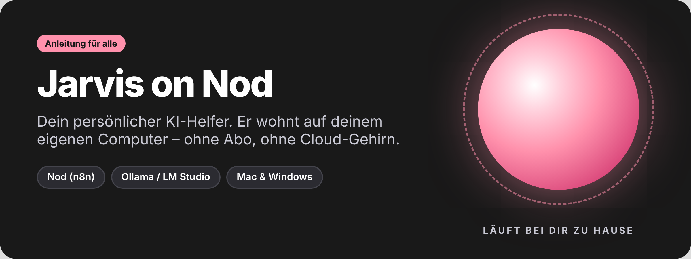
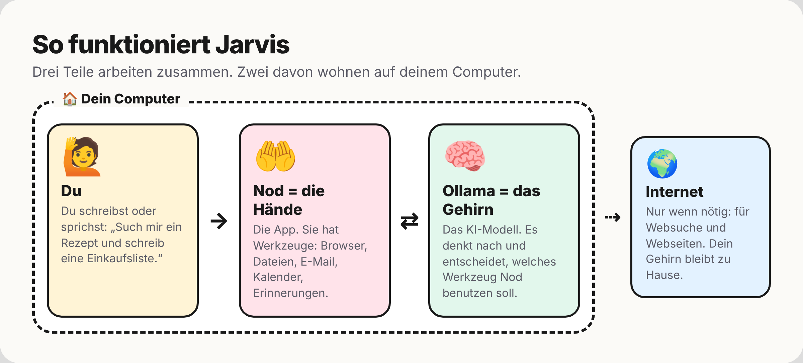
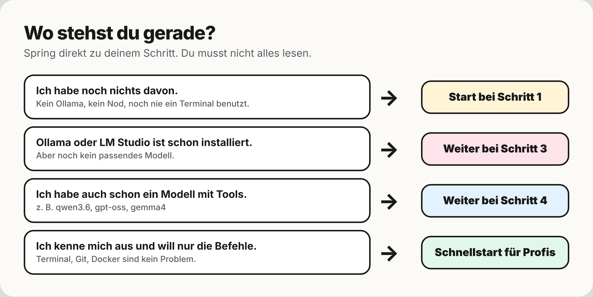
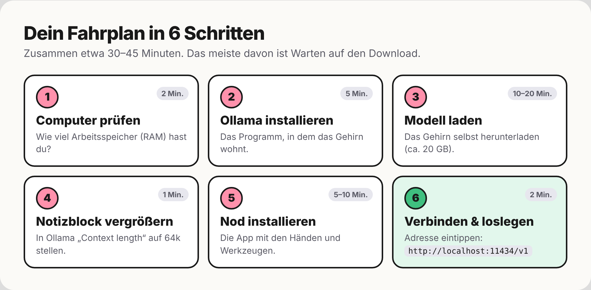
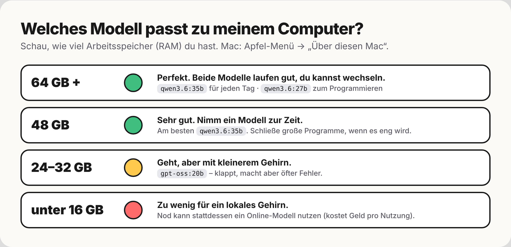
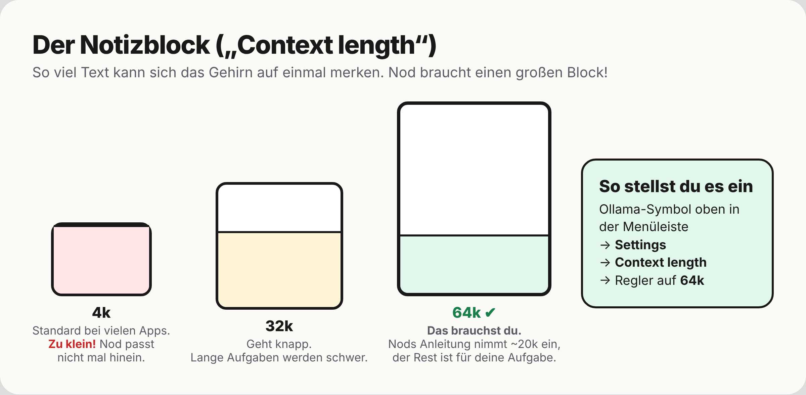
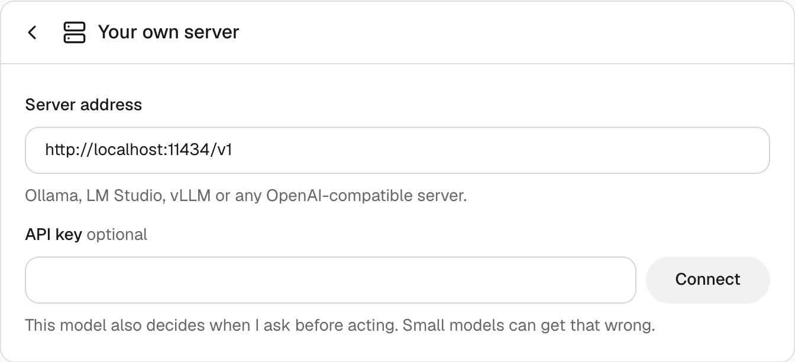
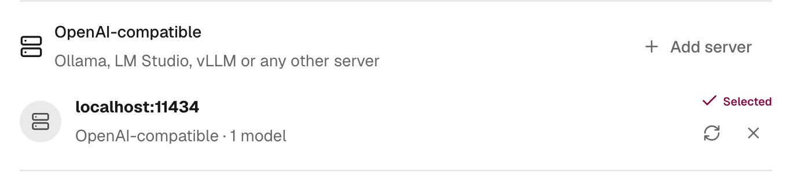
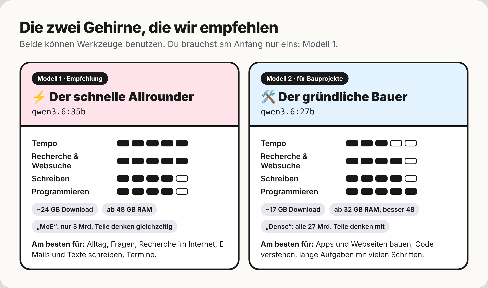
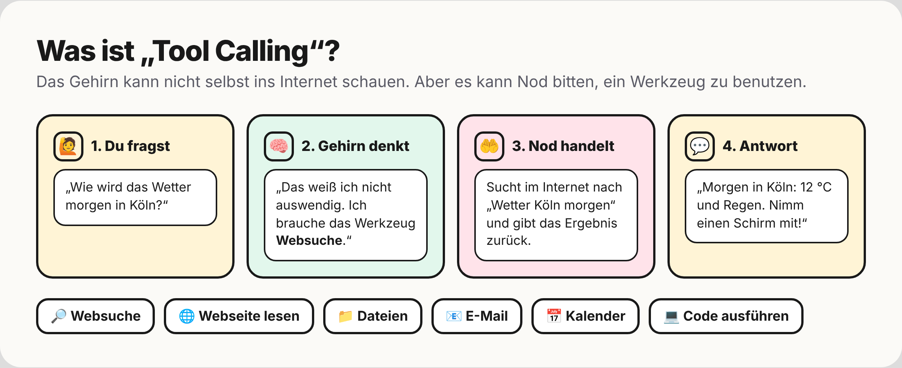

<p align="center">
  
</p>

<p align="center">
  <b>Die einfachste Anleitung, um dir einen eigenen KI-Helfer auf deinen Computer zu holen.</b><br />
  Ohne Programmieren. Ohne Abo. Dein Gehirn bleibt zu Hause.
</p>

<p align="center">
  <a href="#checkliste">✅ Checkliste</a> ·
  <a href="#ein-befehl">⚡ Ein-Befehl-Weg</a> ·
  <a href="#schritt-1">🪜 Schritt für Schritt</a> ·
  <a href="#modelle">🧠 Welches Modell?</a> ·
  <a href="#profis">🧑‍💻 Für Profis</a> ·
  <a href="#hilfe">🆘 Hilfe</a>
</p>

---

## 👋 Was ist das hier?

Stell dir vor, du hast einen Helfer wie **Jarvis** aus Iron Man. Du sagst ihm, was du brauchst, und er erledigt es: im Internet suchen, Texte schreiben, Termine prüfen, Dateien ordnen.

Dieses Repo („Repo“ heißt einfach: ein Projekt-Ordner im Internet) ist eine **Anleitung**. Sie zeigt dir, wie du so einen Helfer auf **deinem eigenen Computer** einrichtest. Dafür nehmen wir zwei kostenlose Programme:

| Teil | Was es ist | Vergleich |
|---|---|---|
| 🤲 **[Nod](https://github.com/n8n-io/nod)** | Eine App von den Machern von n8n. Sie hat Werkzeuge: Browser, Dateien, E-Mail, Kalender, Erinnerungen. | Die **Hände** |
| 🧠 **[Ollama](https://ollama.com)** (oder **[LM Studio](https://lmstudio.ai)**) | Ein Programm, das ein KI-Modell auf deinem Computer laufen lässt. | Das **Gehirn** |

Zusammen sind sie dein **Jarvis**. 🎉

<p align="center">
  
</p>

**Warum lokal?**
- 🔒 Deine Fragen und Gespräche gehen nicht an eine fremde KI-Firma.
- 💶 Es kostet nichts pro Frage. Kein Abo.
- ✈️ Das Gehirn funktioniert auch ohne Internet. (Für Websuche brauchst du natürlich Internet.)

---

<a id="checkliste"></a>
## ✅ Checkliste: Was brauchst du?

Hake ab, was du **schon hast**. Dann springst du direkt zum ersten Punkt, der fehlt.

| | Was | Wofür | So prüfst du es | Fehlt? Dann … |
|---|---|---|---|---|
| ☐ | **Mac mit Apple-Chip** (M1–M5) und **48 GB RAM** oder mehr<br><sub>Windows 11 geht auch (Vorschau-Version)</sub> | Damit das Gehirn schnell genug denkt | Apfel-Menü → **Über diesen Mac** | [Schritt 1](#schritt-1) |
| ☐ | **ca. 40 GB freier Speicherplatz** | Für Modell (~24 GB) und Nod (~2 GB) | Apfel-Menü → **Systemeinstellungen** → **Allgemein** → **Speicher** | Platz schaffen |
| ☐ | **Ollama** (oder LM Studio) | Lässt das Gehirn laufen | Lama-Symbol 🦙 oben in der Menüleiste | [Schritt 2](#schritt-2) |
| ☐ | **Ein Modell mit „Tools“**, z. B. `qwen3.6:35b` | Das Gehirn selbst | Im Terminal: `ollama list` | [Schritt 3](#schritt-3) |
| ☐ | **Kontext auf 64k** (Ollama-Einstellung) | Damit Nod genug „Notizblock“ hat | Im Terminal: `ollama ps` → Spalte **CONTEXT** | [Schritt 4](#schritt-4) |
| ☐ | **Nod-App** | Die Hände mit den Werkzeugen | Ordner **Programme** → **Nod** | [Schritt 5](#schritt-5) |
| ☐ | **Nod mit Ollama verbunden** | Damit Hände und Gehirn zusammenarbeiten | In Nod: **Settings → Models** zeigt `localhost:11434` | [Schritt 6](#schritt-6) |

> 💡 **Du brauchst KEIN GitHub-Konto**, kein Git, kein Docker und kein Node.js. Das alles bringt die Nod-App selbst mit.

<p align="center">
  
</p>

**Direkt springen:** [Ich bin ganz neu → Schritt 1](#schritt-1) · [Ollama ist schon da → Schritt 3](#schritt-3) · [Modell ist schon da → Schritt 4](#schritt-4) · [Ich bin Profi → Schnellstart](#profis)

---

<a id="ein-befehl"></a>
## ⚡ Der Ein-Befehl-Weg (Mac)

Du willst nicht alles von Hand machen? Dann lass den **Helfer-Befehl** die Arbeit erledigen. Er prüft deinen Mac, sucht das passende Modell aus, lädt es herunter, stellt alles richtig ein und testet es.

1. Drücke <kbd>⌘ Cmd</kbd> + <kbd>Leertaste</kbd>, tippe **Terminal** und drücke <kbd>Enter</kbd>.
2. Kopiere diese Zeile, füge sie im Terminal ein (<kbd>⌘ Cmd</kbd> + <kbd>V</kbd>) und drücke <kbd>Enter</kbd>:

```sh
curl -fsSL https://raw.githubusercontent.com/Paulito12209/jarvis-on-nod/main/scripts/jarvis-mac.sh | bash
```

3. Lies, was auf dem Bildschirm steht. Wenn eine Frage kommt, drücke <kbd>Enter</kbd> für „Ja“.
4. Am Ende steht, was du in Nod eintippen musst. Das ist [Schritt 6](#schritt-6).

<details>
<summary><b>Was macht dieser Befehl genau? (Ist das sicher?)</b></summary>
<br />

Gute Frage! Man sollte nie blind Befehle aus dem Internet ausführen. Du kannst den ganzen Helfer hier lesen: [`scripts/jarvis-mac.sh`](scripts/jarvis-mac.sh). Er:

1. liest, wie viel RAM dein Mac hat,
2. wählt das passende Modell (48 GB+ → `qwen3.6:35b`, darunter → `gpt-oss:20b`),
3. hilft dir, Ollama zu installieren (über die offizielle Webseite oder Homebrew),
4. stellt den Kontext auf 64k (`OLLAMA_CONTEXT_LENGTH=65536`),
5. lädt das Modell und macht einen **echten Werkzeug-Test**,
6. fragt dich, ob er die **offizielle** Nod-App installieren soll (mit dem Installer von n8n).

Er löscht nichts und braucht kein Administrator-Passwort.

**Nur prüfen, ohne etwas zu ändern:**
```sh
curl -fsSL https://raw.githubusercontent.com/Paulito12209/jarvis-on-nod/main/scripts/jarvis-mac.sh | bash -s -- --check
```

**Lieber das Programmier-Modell?**
```sh
curl -fsSL https://raw.githubusercontent.com/Paulito12209/jarvis-on-nod/main/scripts/jarvis-mac.sh | bash -s -- --model qwen3.6:27b
```

**Windows 11?** Öffne **PowerShell** (nicht als Administrator) und füge ein:
```powershell
irm https://raw.githubusercontent.com/Paulito12209/jarvis-on-nod/main/scripts/jarvis-windows.ps1 | iex
```
</details>

---

## 🪜 Schritt für Schritt

Lieber alles selbst machen und verstehen? Super! Hier ist dein Fahrplan.

<p align="center">
  
</p>

<a id="schritt-1"></a>
### Schritt 1 · Ist mein Computer stark genug? ⏱️ 2 Min.

Ein KI-Gehirn braucht viel **Arbeitsspeicher** (RAM). Das ist der Platz, an dem der Computer gerade denkt. Je mehr, desto größer und klüger darf das Gehirn sein.

**So findest du es heraus (Mac):**
1. Klicke oben links auf das **Apfel-Symbol**.
2. Klicke auf **Über diesen Mac**.
3. Schau bei **Chip** (sollte „Apple M…“ sein) und **Speicher** (das ist der RAM).

<p align="center">
  
</p>

> 🧮 **Beispiel:** Ein Mac mini M5 Pro mit 64 GB ist perfekt. Er kann beide empfohlenen Modelle laufen lassen. Mit 48 GB klappt es auch sehr gut.

<a id="schritt-2"></a>
### Schritt 2 · Das Gehirn-Programm installieren ⏱️ 5 Min.

Du hast zwei Möglichkeiten. **Nimm Weg A, wenn du unsicher bist.**

<details open>
<summary><b>Weg A: Ollama (empfohlen)</b></summary>
<br />

1. Öffne **[ollama.com/download](https://ollama.com/download)**.
2. Klicke auf **Download for macOS**.
3. Öffne die heruntergeladene Datei und ziehe **Ollama** in den Ordner **Programme**.
4. Starte Ollama. Oben rechts in der Menüleiste erscheint ein kleines **Lama** 🦙. Das heißt: Ollama läuft.

**Test:** Öffne das Terminal (<kbd>⌘ Cmd</kbd> + <kbd>Leertaste</kbd> → „Terminal“) und tippe:
```sh
ollama --version
```
Siehst du eine Zahl wie `ollama version is 0.x.x`? Perfekt! ✅
</details>

<details>
<summary><b>Weg B: LM Studio (mit schöner Oberfläche)</b></summary>
<br />

1. Öffne **[lmstudio.ai](https://lmstudio.ai)** und lade die Mac-Version.
2. Installiere sie wie jede andere App und öffne sie.
3. Das Modell lädst du in [Schritt 3](#schritt-3) direkt in LM Studio über die **Suche** (Lupe).

**Wichtig bei LM Studio:** Die Adresse für Nod ist später `http://localhost:1234/v1` (nicht 11434).
</details>

<details>
<summary><b>💡 Was ist eigentlich das „Terminal“?</b></summary>
<br />

Das Terminal ist ein Fenster, in das man Befehle tippt, statt zu klicken. Keine Angst: Du kannst damit nichts kaputt machen, solange du nur die Befehle aus dieser Anleitung benutzt.

- **Öffnen:** <kbd>⌘ Cmd</kbd> + <kbd>Leertaste</kbd>, „Terminal“ tippen, <kbd>Enter</kbd>.
- **Befehl einfügen:** <kbd>⌘ Cmd</kbd> + <kbd>V</kbd>, dann <kbd>Enter</kbd>.
- **Etwas abbrechen:** <kbd>Ctrl</kbd> + <kbd>C</kbd>.
</details>

<a id="schritt-3"></a>
### Schritt 3 · Das Gehirn (Modell) herunterladen ⏱️ 10–20 Min.

Ein **Modell** ist das eigentliche Gehirn. Es ist eine sehr große Datei (ca. 17–24 GB). Wir empfehlen genau **zwei** Modelle. Mehr dazu im Abschnitt [Welches Modell?](#modelle).

**Mit Ollama:** Tippe im Terminal:

```sh
ollama pull qwen3.6:35b
```

Jetzt läuft ein Balken. Das dauert eine Weile. Zeit für einen Kakao! ☕

> Du willst später auch das Programmier-Modell? Dann zusätzlich: `ollama pull qwen3.6:27b`

**Mit LM Studio:** Klicke auf die **Lupe** 🔍, suche nach **qwen3.6 35b** und klicke **Download**. Auf dem Mac ist die **MLX**-Version meist am schnellsten, wenn es sie gibt.

**Test (Ollama):**
```sh
ollama list
```
Steht `qwen3.6:35b` in der Liste? ✅

<a id="schritt-4"></a>
### Schritt 4 · Den Notizblock vergrößern ⏱️ 1 Min.

**Dieser Schritt ist super wichtig!** Die meisten vergessen ihn, und dann wirkt Jarvis „dumm“.

Das Gehirn hat einen **Notizblock** (auf Englisch: *Context length*). Darauf schreibt es alles, was es sich gerade merken muss. Nod gibt dem Gehirn eine lange Anleitung mit allen Werkzeugen. Die allein braucht schon ca. 20.000 „Wörter“ (Tokens). Viele Programme starten aber mit nur 4.000. Dann passt Nods Anleitung gar nicht drauf!

<p align="center">
  
</p>

**Mit Ollama:**
1. Klicke oben in der Menüleiste auf das **Lama** 🦙.
2. Klicke auf **Settings**.
3. Schiebe **Context length** auf **64k** (oder mehr).
4. Beende Ollama einmal und starte es neu.

**Mit LM Studio:** Wenn du das Modell lädst, stelle **Context Length** auf **65536** (oder mehr).

**Test (Ollama):** Stelle dem Modell eine kurze Frage, damit es lädt, und schau dann nach:
```sh
ollama run qwen3.6:35b "Sag Hallo"
ollama ps
```
In der Spalte **CONTEXT** sollte **65536** stehen. ✅

<a id="schritt-5"></a>
### Schritt 5 · Nod installieren ⏱️ 5–10 Min.

1. Lade Nod für deinen Mac: **[Nod für Apple-Chip (M1–M5)](https://github.com/n8n-io/nod/releases/latest/download/nod-arm64.dmg)**
   <sub>(Älterer Mac mit Intel? [Hier](https://github.com/n8n-io/nod/releases/latest/download/nod-x64.dmg). Windows 11? [Hier](https://github.com/n8n-io/nod/releases/latest/download/nod-Setup-x64.exe).)</sub>
2. Öffne die Datei und ziehe **Nod** in den Ordner **Programme**.
3. Öffne Nod. Der Mac fragt: „Möchtest du das öffnen?“ → **Öffnen**.
4. Klicke auf **Get started**.
5. Nod lädt jetzt einmal seinen eigenen kleinen „Computer im Computer“ herunter (ca. 1,8 GB). Lass das Internet an und warte, bis es fertig ist.

> 🔐 Fragt der Mac nach deinem **Schlüsselbund-Passwort**? Das ist normal. Nod speichert damit deine Passwörter sicher.

<a id="schritt-6"></a>
### Schritt 6 · Hände und Gehirn verbinden ⏱️ 2 Min.

Jetzt sagst du Nod, wo das Gehirn wohnt.

1. Wenn Nod nach einem Modell fragt: Klicke auf **More providers** und dann auf **Your own server**.
   <sub>(Später findest du das unter **Settings → Models → Add → OpenAI-compatible**.)</sub>
2. Bei **Server address** steht schon `http://localhost:11434/v1`. Das ist Ollama. ✅
   <sub>(Bei LM Studio änderst du es zu `http://localhost:1234/v1`.)</sub>
3. **API key**: leer lassen.
4. Klicke auf **Connect**.

<p align="center">
  
  <br /><sub>Echter Screenshot aus Nod (© n8n GmbH, Apache 2.0)</sub>
</p>

5. Wähle dein Modell aus: **qwen3.6:35b**.

Wenn alles klappt, siehst du unter **Settings → Models** so etwas:

<p align="center">
  
  <br /><sub>Echter Screenshot aus Nod (© n8n GmbH, Apache 2.0)</sub>
</p>

🎉 **Geschafft! Dein Jarvis lebt.**

---

<a id="erste-aufgaben"></a>
## 🚀 Probier es aus: Deine ersten Aufgaben

Schreib Jarvis einfach, was du willst. Ganz normal, wie einer Person. Hier ein paar Ideen:

| Was du schreibst | Was Jarvis dafür benutzt |
|---|---|
| „Was sind heute die wichtigsten Nachrichten zu KI? Fasse sie in 5 Punkten zusammen.“ | 🔎 Websuche, 🌐 Webseiten lesen |
| „Vergleiche die drei besten Kaffeemaschinen unter 300 € und mach eine Tabelle.“ | 🔎 Websuche, ✍️ Schreiben |
| „Schreib eine freundliche E-Mail an meinen Vermieter wegen der kaputten Heizung.“ | ✍️ Schreiben |
| „Erinnere mich jeden Montag um 9 Uhr an meine Wochenplanung.“ | ⏰ Zeitpläne |
| „Bau mir eine kleine Webseite für meinen Hundesitter-Service.“ | 💻 Code (nimm dafür Modell 2) |

> 🐢 **Die erste Antwort dauert länger.** Das Gehirn muss erst „aufwachen“ und Nods lange Anleitung lesen. Danach geht es schneller.

---

<a id="modelle"></a>
## 🧠 Welches Modell soll ich nehmen?

Es gibt tausende Modelle. Wir machen es dir leicht: **Nimm eins von diesen zwei.** Beide sind kostenlos, beide können Werkzeuge benutzen, beide laufen gut auf einem Mac mit 48–64 GB.

<p align="center">
  
</p>

### ⚡ Modell 1: Der schnelle Allrounder · `qwen3.6:35b`

**Nimm dieses Modell zuerst.**

- **Warum schnell?** Es ist ein sogenanntes **MoE-Modell** („Mixture of Experts“). Stell dir eine Firma mit 35 Milliarden Mitarbeitern vor. Bei jeder Frage arbeiten aber nur die 3 Milliarden, die sich damit am besten auskennen. Darum antwortet es flott.
- **Super für:** Fragen beantworten, im Internet recherchieren, Texte und E-Mails schreiben, Zusammenfassungen, Alltags-Aufgaben.
- **Download:** ca. 24 GB · **RAM:** ab 48 GB empfohlen
- **Laden:** `ollama pull qwen3.6:35b`

### 🛠️ Modell 2: Der gründliche Bauer · `qwen3.6:27b`

**Hol dir dieses Modell, wenn du etwas bauen willst.**

- **Warum gründlich?** Es ist ein **Dense-Modell**. Hier arbeiten bei jeder Frage alle 27 Milliarden „Mitarbeiter“ mit. Das ist langsamer, aber sehr sorgfältig. Beim Programmieren gehört es zu den stärksten Modellen, die auf einen Heim-Computer passen.
- **Super für:** Apps und Webseiten bauen, Code verstehen und reparieren, lange Aufgaben mit vielen Schritten.
- **Download:** ca. 17 GB · **RAM:** ab 32 GB, besser 48 GB
- **Laden:** `ollama pull qwen3.6:27b`

> 🔁 **Wechseln:** In Nod unter **Settings → Models** kannst du jederzeit das andere Modell auswählen. Mit 64 GB kannst du beide installiert haben. Mit 48 GB nimm am besten immer nur eins zur Zeit.

<details>
<summary><b>Warum keine anderen Modelle?</b></summary>
<br />

- **Größere Modelle** (z. B. 65 Milliarden „Teile“ und mehr) passen kaum auf 64 GB, weil Nod und dein Mac auch noch Platz brauchen.
- **Kleinere Modelle** sind schneller, machen aber mehr Fehler. Das ist bei Nod wichtig: Das Modell entscheidet auch mit, **wann Nod dich vorher fragen muss**. Kleine Modelle liegen da öfter falsch.
- **Wichtig ist „Tools“:** Ein Modell ohne Werkzeug-Fähigkeit kann in Nod nur plaudern. Auf [ollama.com](https://ollama.com/search?c=tools) erkennst du gute Modelle am Etikett **tools**.
- Die Modell-Welt ändert sich schnell. Diese Empfehlung ist vom **November 2026**.
</details>

### 🔎 Warum ist Websuche so wichtig?

Ein Modell hat irgendwann aufgehört zu lernen. Alles, was danach passiert ist, **weiß es nicht**. Es ist wie ein sehr kluger Freund, der ein Jahr auf einer einsamen Insel war.

Mit **Websuche** kann Jarvis nachschauen:
- 📰 **Neue Fakten:** Nachrichten, Preise, Wetter, Öffnungszeiten.
- 📚 **Recherche:** Mehrere Quellen lesen, vergleichen und zusammenfassen.
- ✅ **Weniger Erfinden:** Statt zu raten, liest Jarvis nach und nennt die Quelle.

Nod hat Websuche schon eingebaut. Du musst nichts extra einrichten.

### 🧰 Was ist „Tool Calling“?

**Tool Calling** heißt: Das Gehirn kann **Werkzeuge benutzen**. Es kann selbst nicht klicken oder ins Internet gehen. Aber es kann Nod sagen: „Bitte benutze jetzt die Websuche mit diesen Wörtern.“ Nod macht das und gibt das Ergebnis zurück.

<p align="center">
  
</p>

Dafür ist Tool Calling gut:
- 🔎 **Recherche:** suchen, Webseiten lesen, Fakten prüfen.
- 💻 **Programmieren:** Code schreiben, ausführen, Fehler finden, Dateien speichern.
- 📧 **Erledigungen:** E-Mails entwerfen, Termine eintragen, Erinnerungen setzen.

**Keine Sorge:** Bevor Nod etwas Wichtiges für dich tut (z. B. eine E-Mail abschicken), **fragt es dich vorher**. Darum heißt es „Nod“, wie ein Nicken: Es wartet auf dein Okay.

---

<a id="hilfe"></a>
## 🆘 Hilfe! Etwas klappt nicht

| Problem | Lösung |
|---|---|
| Nod sagt **„This server has no models Nod can use“** | Dein Modell kann keine Werkzeuge. Lade eins der [zwei empfohlenen Modelle](#modelle). |
| Nod sagt **„Model discovery failed“** | Läuft Ollama? Schau nach dem Lama 🦙 oben in der Menüleiste. Test im Terminal: `curl http://localhost:11434/v1/models` |
| Jarvis **vergisst seine Werkzeuge**, wiederholt sich oder ignoriert dich | Der Notizblock ist zu klein. Mach [Schritt 4](#schritt-4) nochmal und starte Ollama neu. |
| Die **erste Antwort dauert ewig** | Das ist normal (bis zu 1–2 Minuten). Nach einer Minute zeigt Nod „Waiting for …“. Einfach warten. |
| Der Mac wird **sehr langsam** | Zu wenig RAM frei. Schließe große Programme (z. B. Spiele, viele Browser-Tabs) oder nimm Modell 2 (kleiner). |
| Ein **neues Modell** erscheint nicht in Nod | Settings → Models → **Manage** neben „OpenAI-compatible“ → dieselbe Adresse nochmal hinzufügen. Das lädt die Liste neu. |
| Nod **fragt vor fast allem** nach | Kleine Modelle sind bei dieser Entscheidung unsicher. Nimm `qwen3.6:35b` oder `qwen3.6:27b`. |
| **Ich weiß nicht, was fehlt** | Lass den Prüf-Befehl laufen. Er ändert nichts und zeigt dir rot, was fehlt: <br />`curl -fsSL https://raw.githubusercontent.com/Paulito12209/jarvis-on-nod/main/scripts/jarvis-mac.sh \| bash -s -- --check` |

Noch mehr Hilfe: [Nod-Doku zu lokalen Modellen (Englisch)](https://nod.n8n.io/docs/connect/local-models/) · [Nod Discord](https://discord.gg/n8n)

---

<a id="profis"></a>
## 🧑‍💻 Schnellstart für Profis

Du kennst Terminal, Homebrew und `.env`-Dateien? Hier ist alles in Kurzform.

```sh
# 1) Ollama + Modell
brew install --cask ollama
launchctl setenv OLLAMA_CONTEXT_LENGTH 65536   # oder in der Ollama-App: Settings → Context length
open -a Ollama
ollama pull qwen3.6:35b        # Allrounder (MoE, 3B aktiv, ~24 GB)
ollama pull qwen3.6:27b        # Coding (dense, ~17 GB), optional

# Prüfen: Tool-Fähigkeit + geladener Kontext
curl -s localhost:11434/api/show -d '{"model":"qwen3.6:35b"}' | grep -o '"capabilities":[^]]*]'
ollama run qwen3.6:35b "hi" >/dev/null && ollama ps

# 2) Nod Desktop (offizieller Installer von n8n)
curl -fsSL https://raw.githubusercontent.com/n8n-io/nod/main/deployment/n8n/install.sh | sh

# 3) In Nod: More providers → Your own server → http://localhost:11434/v1
```

**Nod aus dem Quellcode** (braucht Node.js 24.21+, pnpm, Docker):

```sh
git clone https://github.com/n8n-io/nod.git && cd nod
corepack enable
pnpm start            # erzeugt .env aus .env.example
```

Dann in `nod/.env`:

```sh
LLM_PROVIDER=compatible
OPENAI_COMPATIBLE_BASE_URL=http://localhost:11434/v1   # LM Studio: http://localhost:1234/v1
OPENAI_COMPATIBLE_API_KEY=
LLM_MODEL=qwen3.6:35b
# NOD_TRUST_MODEL=selected  # Standard: dein Modell prüft Aktionen selbst (niedrigste Reasoning-Stufe)
```

**Gut zu wissen:**
- Nod braucht **Tool Calling** und **≥ 64k Kontext** (System-Prompt + Tools ≈ 20k Tokens).
- Mit einem `localhost`-Modell kostet Chat nichts. Der **Trust-Check** nutzt standardmäßig dein gewähltes Modell. Mit `NOD_TRUST_MODEL=llm` oder `decision` kann ein externer kleiner Checker genutzt werden (kann API-Kosten haben). Details: [Decision checks](https://nod.n8n.io/docs/connect/models/#decision-checks).
- Websuche läuft über Nods eingebautes Web-Plugin (Standard: Exa, ohne API-Key über Exas öffentlichen Dienst). Die Suchanfrage selbst geht also ins Internet.
- vLLM: `--enable-auto-tool-choice --tool-call-parser <parser> --max-model-len 65536`; llama.cpp: `llama-server -c 65536 --jinja`.

---

## 🔒 Was bleibt privat?

- **Deine Gespräche mit dem Gehirn** bleiben auf deinem Computer (bei Ollama/LM Studio).
- **Websuche** schickt die Suchwörter an einen Suchdienst. Webseiten, die Jarvis liest, sehen den Besuch.
- **Verbundene Apps** (Gmail, Kalender …) laufen über einen Verbindungsdienst von n8n.
- **Nutzungsdaten:** Nod schickt standardmäßig einfache Nutzungsdaten an n8n. Ausschalten: **Settings → Privacy & data → Share usage data**.

Genau nachlesen: [Nod: Your data and privacy](https://nod.n8n.io/docs/trust/privacy/)

---

## 💻 Kein starker Computer?

- **24–32 GB RAM:** Nimm `gpt-oss:20b` (`ollama pull gpt-oss:20b`). Das klappt, macht aber mehr Fehler.
- **Weniger RAM:** Ein lokales Gehirn wird zu langsam. Nod kann stattdessen ein **Online-Modell** nutzen (z. B. mit einem ChatGPT-Abo oder einem API-Schlüssel). Das kostet Geld und ist nicht mehr ganz privat. Anleitung: [Nod: Models](https://nod.n8n.io/docs/connect/models/).

---

## 📖 Kleines Wörterbuch

| Wort | Einfach erklärt |
|---|---|
| **KI-Modell / LLM** | Das „Gehirn“. Eine große Datei, die gelernt hat, Sprache zu verstehen und zu schreiben. |
| **Lokal** | Auf deinem eigenen Computer, nicht im Internet. |
| **RAM / Arbeitsspeicher** | Der Platz, an dem der Computer gerade denkt. Je mehr, desto größer darf das Gehirn sein. |
| **Ollama / LM Studio** | Programme, die ein Gehirn auf deinem Computer laufen lassen. |
| **Nod** | Die App mit den Werkzeugen. Sie fragt das Gehirn, was zu tun ist, und tut es dann. |
| **Tool Calling** | Das Gehirn kann Werkzeuge benutzen (suchen, Dateien öffnen, Code ausführen …). |
| **Kontext / Context length** | Der Notizblock des Gehirns. So viel Text kann es sich auf einmal merken. |
| **Token** | Ein Stückchen Text, ungefähr ein Wortteil. 1.000 Tokens ≈ 750 Wörter. |
| **MoE (Mixture of Experts)** | Ein Gehirn, bei dem pro Frage nur die passenden „Experten“ arbeiten. Schnell! |
| **Dense** | Ein Gehirn, bei dem immer alle Teile mitarbeiten. Gründlich, aber langsamer. |
| **Terminal** | Ein Fenster, in das man Befehle tippt statt zu klicken. |
| **localhost** | „Dieser Computer hier.“ `localhost:11434` heißt: Ollama auf deinem Computer. |
| **Repo** | Ein Projekt-Ordner auf GitHub. Wie dieser hier. |

---

## 🤔 Warum Nod und nicht OpenJarvis?

[OpenJarvis](https://github.com/open-jarvis/OpenJarvis) (Stanford) ist auch ein toller, lokaler Jarvis. Er läuft ebenfalls mit Ollama, LM Studio, MLX und anderen lokalen Gehirnen. Er ist aber eher für Entwickler und Forscher gedacht (Python, Kommandozeile, viele Einstellungen).

**Nod** hat eine fertige App mit Knöpfen, fragt vor wichtigen Aktionen nach und lässt sich ohne Programmieren einrichten. Darum nutzen wir hier Nod.

---

## 📁 Was ist in diesem Repo?

```
jarvis-on-nod/
├── README.md                 ← diese Anleitung
├── scripts/
│   ├── jarvis-mac.sh         ← Helfer-Befehl für den Mac (einrichten + prüfen)
│   └── jarvis-windows.ps1    ← Helfer-Befehl für Windows 11
├── docs/
│   ├── bilder/               ← alle Bilder dieser Anleitung
│   └── quellen/              ← Quelldateien der Bilder (HTML), zum Ändern
└── NOTICE                    ← Hinweise zu fremden Inhalten (Nod-Screenshots)
```

<details>
<summary>Bilder neu erzeugen (für Mitmacher)</summary>
<br />

Die Grafiken entstehen aus [`docs/quellen/bilder.html`](docs/quellen/bilder.html). Ändere den Text dort und erzeuge die Bilder neu (braucht Node.js und Playwright):

```sh
node docs/quellen/render.js docs/bilder
```
</details>

---

<p align="center">
  <sub>
    Nod ist ein Projekt von <a href="https://n8n.io">n8n</a> (<a href="https://github.com/n8n-io/nod">github.com/n8n-io/nod</a>, Apache 2.0).<br />
    Diese Anleitung ist ein unabhängiges Community-Projekt und nicht von n8n.<br />
    Stand der Anleitung: November 2026.
  </sub>
</p>
