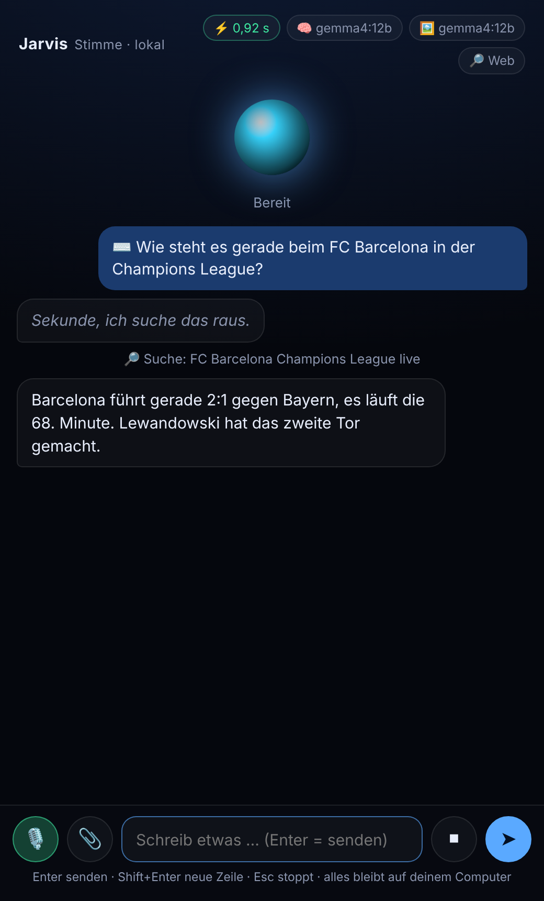

# 🎙️ Jarvis Stimme

**Du redest, Jarvis antwortet sofort mit deutscher Stimme. Alles läuft auf deinem eigenen Computer.**

Andere Programme warten, bis die KI ihre ganze Antwort fertig geschrieben hat, und lesen sie erst dann vor. Das fühlt sich langsam an.
Jarvis Stimme fängt schon an zu sprechen, während die KI noch weiterdenkt. Ziel: **die erste Silbe in unter einer Sekunde**, nachdem du aufgehört hast zu reden.

---

## ⚡ Starten (ein Befehl)

Öffne das Programm **Terminal** und füge das ein:

```sh
bash <(curl -fsSL https://raw.githubusercontent.com/Paulito12209/jarvis-on-nod/main/scripts/jarvis-stimme.sh)
```

Oder, wenn du das Repo schon hast, im Repo-Ordner:

```sh
./scripts/jarvis-stimme.sh
```

Das Skript macht alles allein: Es prüft Ollama, installiert die Programme (nur beim ersten Mal, in `~/.jarvis-stimme`), sucht die deutsche Stimme „Thorsten“ (und lädt sie sonst herunter) und startet. Dann einfach **losreden**. 🗣️

> 💡 Beim allerersten Start lädt Whisper (die „Ohren“, ca. 1,5 GB) einmal herunter. macOS fragt nach dem **Mikrofon** – bitte „Erlauben“ klicken.

**Beenden:** Sag „Tschüss Jarvis“ oder drück `Ctrl + C`.

---

## 🧩 So funktioniert es

```
 🎤 Du redest
   │
   ▼
 👂 Silero VAD merkt: „Jetzt ist Pause, du bist fertig“    (0,6 s Stille)
   │
   ▼
 📝 Whisper (MLX, auf der Grafikeinheit) schreibt mit        (~0,2–0,4 s)
   │
   ▼
 🧠 Ollama-Modell denkt und schickt Wort für Wort            (Denken ist AUS = schneller)
   │   ┌───────────────────────────────────────────────┐
   │   │ Sobald der erste Satzteil fertig ist, geht er  │
   │   │ sofort zur Stimme. Der Rest kommt hinterher.   │
   │   └───────────────────────────────────────────────┘
   ▼
 🔊 Piper „Thorsten“ spricht Satz für Satz                    (~20× schneller als Echtzeit)
   │
   ✋ Du kannst jederzeit dazwischenreden – dann hört Jarvis sofort auf.
```

Wie schnell die letzte Antwort war, steht oben in der Statusleiste (siehe unten). Alle Antworten kannst du mit `/stats` nachschauen.

---

## 🪟 Mit Fenster (neu in 0.3)

<p align="center"></p>

```sh
./scripts/jarvis-stimme.sh --gui
```

Oder im Finder einfach **`scripts/Jarvis-Fenster.command` doppelklicken**.

Es öffnet sich ein Fenster mit:
- einer **leuchtenden Kugel**: blau = bereit, grün = hört zu (bewegt sich mit deiner Stimme), lila = denkt, türkis = spricht,
- dem **Gespräch als Sprechblasen**, live Wort für Wort,
- einem **Eingabefeld** zum Tippen (Enter = senden),
- 🎙️ **Mikro an/aus** (Taste M), ⏹ **Stopp** (Esc),
- 📎 **Bilder**: reinziehen, mit ⌘V einfügen oder über die Büroklammer auswählen.

Das Fenster läuft in deinem Browser, aber nur auf deinem Computer (`http://127.0.0.1:8765`). Mikrofon und Lautsprecher bleiben bei Python, darum ist es genauso schnell wie im Terminal. Andere Webseiten dürfen nicht mit Jarvis reden.

---

## 🖥️ Terminal-Oberfläche (neu in 0.5)

Im Terminal sieht Jarvis jetzt ähnlich aus wie Claude Code:

```
 🤖 Jarvis · 🧠 gemma4:12b · 📚 █░░░░░ 1.734/8.192 (21 %) · letzte: ⚡0,9 s · 84 Tokens · 🎙️ an   ← Statusleiste
Du › Wie steht es gerade beim FC Barcelona?
💬 Sekunde, ich suche das raus.
🔎 Suche: FC Barcelona Champions League live
✓ 5 Treffer gefunden
Jarvis › Barcelona führt gerade 2:1 gegen Bayern, es läuft die 68. Minute …

 ⠹ sucht im Web … 1,2 s                                                     ← Lade-Anzeige
› _                                                                         ← hier tippen
 Enter senden · ^O Mikro · ^B Bild · Esc Stopp · /hilfe Befehle · ^C Ende   ← Tastenkürzel
```

- **Statusleiste oben**: Name, Modell, wie voll der Kontext ist, und wie schnell die **letzte** Antwort war. Keine Zeit-Zeile mehr unter jeder Antwort.
- **Lade-Anzeige**: Ein drehendes Zeichen zeigt immer, was gerade passiert: „denkt …“, „sucht im Web …“, „schaut sich das Bild an …“, beim Zuhören ein Pegel ▁▃▆, beim Sprechen eine Welle.
- **Eingabezeile** mit blinkendem Cursor, darunter die Tastenkürzel.
- Der **Brückensatz** (💬) steht immer in einer eigenen Zeile vor der Antwort, nie mitten drin.

| Taste / Befehl | Was passiert |
|---|---|
| `Enter` | Senden |
| `↑` / `↓` | Frühere Eingaben (bleiben auch nach dem Neustart) |
| `Esc` | Jarvis sofort stoppen |
| `Ctrl+O` oder `/mikro` | Mikrofon an/aus |
| `Ctrl+B` oder `/bild` | Bild auswählen (Mac: Finder-Fenster) |
| `Bild↑` / `Bild↓` | Im Gespräch hoch- und runterblättern |
| `Ctrl+L` oder `/leeren` | Bildschirm leeren |
| `/name Friday` | Namen ändern (wird gespeichert) |
| `/stats` | Zeit und Tokens der letzten 10 Antworten, mit Schnitt |
| `/neu` | Neues Gespräch (Gedächtnis leeren) |
| `/hilfe` | Alle Befehle |
| `Ctrl+C` oder `/ende` | Beenden |

**Jede Antwort wird mitgeschrieben** in `~/.jarvis-stimme/statistik.jsonl` (Uhrzeit, Sekunden bis zum ersten Ton, Tokens, ob gesucht wurde). So kannst du später jede Nachricht nachverfolgen.

**Kontext** (📚) zeigt, wie viel vom „Notizblock“ des Modells schon belegt ist. Wenn der Balken voll wird, vergisst Jarvis den Anfang des Gesprächs. Mehr Platz gibt es mit `--kontext 16384`, das ist aber etwas langsamer.

Tippen und Sprechen laufen in **dieselbe Warteschlange**: Was zuletzt kommt, gewinnt, und Jarvis hört mit dem Alten sofort auf. Mit `--gui` kommt zusätzlich das Fenster dazu. Die alte, schlichte Ansicht gibt es mit `--einfach`.

---

## ✨ Neu in Version 0.2: natürlicher, schlauer, aufmerksamer

### 👋 Ein eigener Name
Beim ersten Start wählst du den Namen mit den **Pfeiltasten ↑/↓ und Enter**, ganz ohne Tippen:

```
  Wie soll dein Assistent heißen?  (↑/↓ und Enter)
  ❯ Jarvis   der Klassiker aus Iron Man
    Friday   Tony Starks Assistentin nach Jarvis
    Ultron   etwas düsterer
    HAL      aus 2001: Odyssee im Weltraum
    ✏️  Eigenen Namen eingeben
```

Die Wahl wird gemerkt. Danach reagiert er nur, wenn du seinen Namen sagst, zum Beispiel „Jarvis, wie wird das Wetter?“.
Nach einer Antwort bleibt das Gespräch **30 Sekunden offen**: Dann musst du den Namen nicht jedes Mal wiederholen.
Einfach nur „Jarvis?“ sagen, und er antwortet sofort „Ja?“, ganz ohne Nachdenken.

- „Jarvis, sei mal still“ oder „Jarvis, ich telefoniere“ → Ruhe, bis du ihn wieder beim Namen rufst.
- Name ändern: `./scripts/jarvis-stimme.sh --einrichten`
- Auf alles reagieren (wie früher): `--zuhoeren immer`

### 🚦 Der Entscheider: „Ist das für mich?“
Ein **kleines, blitzschnelles Modell** (bei dir `qwen3.5:2b`) hört mit und entscheidet in Bruchteilen einer Sekunde, ob du gerade mit Jarvis redest.
Wenn du einem Freund eine WhatsApp diktierst („Schreib Tom, ich komme später“), telefonierst oder mit jemandem im Raum sprichst, bleibt Jarvis still.
Damit es nicht langsamer wird, fängt das große Modell **gleichzeitig** schon an zu denken. Gesprochen wird erst, wenn der Entscheider „ja“ sagt.

### 💬 Brückensätze und Einatmen
Wie ein Mensch sagt Jarvis kurz **„Mhm.“**, **„Gute Frage.“**, **„Okay, mach ich.“** oder **„Oh, das klingt nicht schön.“**, wenn die echte Antwort noch nicht fertig ist. Es gibt **über 100 Sätze**, passend zur Situation (Frage, Bitte, Erzählung, Gefühl, Meinung, Suche). Sie werden beim Start einmal vorbereitet und kommen dann **ohne jede Wartezeit**.
Ist das Modell schnell genug, lässt Jarvis die Brücke weg. Manchmal atmet er vorher auch leise ein.
Ausschalten: `--ohne-bruecken` oder `--ohne-atmen`.

### 🔎 Websuche
Jarvis kann jetzt **im Internet suchen**, z. B. nach Spielständen, Nachrichten, Wetter oder Preisen. Das ist kostenlos und braucht keinen Schlüssel (DuckDuckGo).
Nur die Suchwörter gehen ins Internet, deine Stimme und das Modell bleiben lokal. Während er sucht, sagt er „Moment, ich schau kurz nach.“
Wer eine eigene Suchmaschine betreibt: `JARVIS_SEARXNG=http://localhost:8080`. Ausschalten: `--ohne-websuche`.

### 🖼️ Bilder ansehen
Zieh ein Bild ins Terminal-Fenster (oder tippe den Pfad) und drück Enter, gern mit einer Frage dazu:

```
/Users/du/Bilder/IMG_0943.HEIC Was ist auf dem Foto?
```

iPhone-Fotos (**HEIC**) werden automatisch umgewandelt. Jarvis nimmt dafür ein Modell, das sehen kann (z. B. `gemma4:12b`), auch wenn du sonst ein anderes nutzt. Ist keins da, sagt er das ehrlich.

### ⌨️ Tippen und Sprechen gleichzeitig
Du kannst jederzeit **tippen + Enter** drücken, auch während das Mikro an ist. Getipptes ist immer für Jarvis gemeint, ein Name ist dafür nicht nötig.

### 🧠 Vorausdenken
Wenn ihr kurz still seid, denkt Jarvis im Hintergrund über euer Thema nach und macht sich Notizen. Die nächste Antwort wird dadurch besser.
Bleibt es länger still (40 Sekunden), bietet er manchmal von sich aus etwas an: „Übrigens, soll ich dir ein schnelles Rezept raussuchen?“ Sobald du redest, hört er sofort auf.
Ausschalten: `--nicht-proaktiv`.

---

## 🛠️ Die Tricks für Tempo

| Trick | Warum es schneller ist |
|---|---|
| **Streaming** | Die KI schickt jedes Wort sofort, nicht erst die ganze Antwort. |
| **Erster Satzteil zuerst** | Schon beim ersten Komma (ab 4 Wörtern) fängt die Stimme an. |
| **Gleichzeitig arbeiten** | Während Satz 1 gesprochen wird, schreibt die KI Satz 2 und die Stimme baut ihn schon. |
| **„Denken“ aus** | Qwen-Modelle denken sonst erst lange still nach. Fürs Reden schalten wir das ab. |
| **Modell bleibt geladen** | Ollama hält das Modell 60 Minuten im Speicher. Kein Neuladen. |
| **Aufwärmen beim Start** | Whisper, Stimme und Modell laufen einmal vorab, damit die erste Frage schnell ist. |
| **Kurzer Notizblock** | 8.000 Tokens Kontext statt 64.000 – reicht fürs Gespräch und ist schneller. |
| **Cache-freundlich** | Der Systemprompt bleibt den ganzen Tag gleich (Uhrzeit und Notizen stehen in der neuesten Nachricht). So muss Ollama das Gespräch nicht jedes Mal neu lesen. |
| **Kurze Antworten** | Jarvis ist angewiesen, wie im Gespräch zu reden: 1–3 Sätze, keine Listen. |
| **Whisper-Unsinn filtern** | Bei Stille erfindet Whisper gern „Untertitel von …“. Das wird ignoriert. |

---

## 🧠 Welches Modell?

Jarvis Stimme sucht sich **automatisch** das schnellste gute Modell aus, das du in Ollama hast. Reihenfolge:

1. `qwen3.6:35b` – „MoE“-Modell: groß und klug, rechnet aber nur mit einem kleinen Teil. **Sehr schnell.** ⭐
2. `gemma4:12b` – klein, schnell, gutes Deutsch.
3. `qwen3.6:27b` / `qwen3.5:27b` – klüger, aber langsamer beim Reden.

Selbst wählen:

```sh
./scripts/jarvis-stimme.sh --modell gemma4:12b
```

Mit `--test` misst Jarvis alles einmal durch und zeigt dir die Zeiten. Probier ruhig mehrere Modelle aus!

---

## 🎛️ Einstellungen

| Option | Was sie macht |
|---|---|
| `--test` | Alles einmal durchmessen (Stimme, Hören, Denken) |
| `--modell NAME` | Bestimmtes Ollama-Modell nehmen |
| `--pause 0.4` | Schneller merken, dass du fertig bist (Standard 0,6 s). Zu klein = Jarvis fällt dir ins Wort. |
| `--tempo 1.15` | Stimme spricht schneller (Standard 1,05) |
| `--ohne-unterbrechen` | Kein Dazwischenreden. **Nimm das, wenn Jarvis sich über die Lautsprecher selbst unterbricht.** |
| `--empfindlichkeit 0.9` | Dazwischenreden muss deutlicher sein (Standard 0,85) |
| `--tippen` | Tippen statt sprechen (Antwort kommt trotzdem als Stimme) |
| `--geraete` | Mikrofone und Lautsprecher anzeigen |
| `--mikro 2` / `--lautsprecher 3` | Bestimmtes Gerät nehmen |
| `--stimme PFAD` | Andere Piper-Stimme (`.onnx`-Datei) |
| `--gui` | Mit Fenster starten |
| `--einfach` | Schlichte Terminal-Ansicht statt der neuen Oberfläche |
| `--ohne-statuszeile` | In der schlichten Ansicht: keine Statuszeile oben |
| `--port 8800` / `--kein-browser` | Anderer Port / Fenster nicht automatisch öffnen |
| `--einrichten` | Name und Zuhör-Art neu festlegen |
| `--zuhoeren immer` | Auf alles reagieren, nicht nur auf den Namen |
| `--fenster 60` | So lange (Sekunden) nach einer Antwort ohne Namen weiterreden |
| `--entscheider qwen3.5:2b` | Welches kleine Modell entscheidet („aus“ = keins) |
| `--bildmodell gemma4:12b` | Welches Modell Bilder ansieht |
| `--ohne-bruecken` / `--ohne-atmen` | Keine Brückensätze / kein Einatmen |
| `--ohne-websuche` | Keine Websuche |
| `--nicht-proaktiv` | Kein Vorausdenken, keine „Übrigens …“-Vorschläge |

> 🎧 **Tipp:** Mit Kopfhörern klappt das Dazwischenreden am besten. Über Lautsprecher hört das Mikrofon Jarvis' eigene Stimme. Dafür ist die Empfindlichkeit beim Reden extra hoch eingestellt.

---

## 🆘 Hilfe

| Problem | Lösung |
|---|---|
| „Ollama ist nicht erreichbar“ | Ollama-App starten (Lama-Symbol oben in der Menüleiste). |
| Jarvis hört nichts | Systemeinstellungen → Datenschutz → **Mikrofon** → Terminal erlauben. Mit `--geraete` prüfen, welches Mikro aktiv ist. |
| Jarvis unterbricht sich selbst | `--ohne-unterbrechen` oder Kopfhörer benutzen. |
| Jarvis fällt mir ins Wort | `--pause 0.9` |
| Erste Antwort ist langsam | Normal beim allerersten Mal (Modelle werden geladen). Danach geht es schnell. |
| Antworten sind zu lang/zu kurz | Einfach sagen: „Antworte bitte ausführlicher.“ |
| Jarvis reagiert nicht | Sag seinen Namen am Anfang: „Jarvis, …“. Oder starte mit `--zuhoeren immer`. |
| Jarvis antwortet, obwohl ich jemand anderen meine | `--fenster 10` (kürzeres Gesprächsfenster) |
| „Websuche hat nicht geklappt“ | Internet prüfen. DuckDuckGo blockt manchmal kurz, dann einfach nochmal fragen. |

---

## 🧑‍💻 Für Profis

```
stimme/
├── jarvis_stimme/
│   ├── __main__.py   ← Start, Optionen, --test
│   ├── app.py        ← Gesprächs-Schleife: Turn-Logik, Barge-in, Zeitmessung
│   ├── text.py       ← Satz-Zerleger für den Token-Strom, Markdown/Emoji-Filter
│   ├── llm.py        ← Ollama /api/chat Streaming + Tool-Calls (nur Standardbibliothek), Modellwahl
│   ├── bruecken.py   ← 100+ Brückensätze, Situation erkennen, Einatmen
│   ├── zuhoeren.py   ← Name, Gesprächsfenster, Ruhemodus, Entscheider-Modell (JSON-Schema)
│   ├── werkzeuge.py  ← Websuche (ddgs / SearXNG)
│   ├── bilder.py     ← Bildpfade finden, HEIC umwandeln (sips), Bild-Modell wählen
│   ├── vorausdenken.py ← Hintergrund-Notizen und „Übrigens …“
│   ├── gui.py / gui.html ← Fenster: lokaler Server (SSE), Upload, Mikro-Schalter
│   ├── terminal.py   ← Pfeiltasten-Menü (Namenswahl), Statuszeile oben
│   ├── tui.py        ← Terminal-Oberfläche (prompt_toolkit): Statusleiste, Spinner, Eingabe, Befehle
│   ├── stt.py        ← mlx-whisper (Apple Silicon) oder faster-whisper
│   ├── tts.py        ← Piper, Stimmen-Suche
│   ├── vad.py        ← Silero VAD (pysilero-vad, ohne PyTorch) + Turn-Erkennung
│   └── audio.py      ← Mikrofon und lückenlose Wiedergabe (sounddevice)
└── tests/            ← pytest (ohne Mikrofon und ohne Ollama lauffähig)
```

Tests laufen:

```sh
cd stimme && uv run --with pytest --with-editable . pytest -q
```

Gesucht wird die Stimme in `~/.jarvis-stimme/stimmen`, `~/.openjarvis/voices/piper` und `~/.local/share/piper`.

**Nächste Ideen:** „Smart Turn“ (erkennt am Satzklang, ob du fertig bist, statt nur Stille), eigene Stimme klonen (Chatterbox / F5-TTS), mehr Werkzeuge (Timer, Kalender, Dateien).
